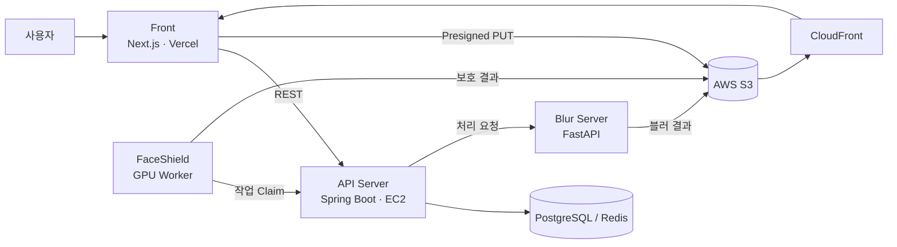

<div align="center">

# DeepFence

**올리기 전에 DeepFence가 먼저 살펴볼게요**

SNS에 사진을 올리기 전에 얼굴에는 딥페이크 방어 노이즈를, 개인정보에는 블러를 입혀 주는 사진 보호 서비스

[서비스 바로가기](https://www.deepfence.site) · [API 문서](https://api.deepfence.site/swagger-ui/index.html)

2026 코디세이 AI 해커톤 · Team ROOT

</div>

---

## 해결하려는 문제

| 문제 | 설명 |
| --- | --- |
| 딥페이크 합성 | SNS에 공개한 얼굴 사진 몇 장만으로 AI가 얼굴을 합성할 수 있고, 한 번 올린 사진은 회수하기 어렵습니다. |
| 사진 속 개인정보 노출 | 차량 번호판, 신분증, 간판처럼 나를 특정할 수 있는 단서가 사진과 함께 올라갑니다. |
| 보호의 유효기간 | 오늘 안전했던 보호 방식도 새로운 생성 모델이 나오면 무력화될 수 있습니다. |

**목표 사용자**: 일상 사진을 자주 올리는 SNS 사용자, 얼굴이 노출되는 크리에이터·강사, 자녀 사진을 공유하는 보호자

## 해결 방법

사진을 올리기 **전**에 한 번 거치는 보호 단계를 제공하고, 올린 **후**에도 계속 관리합니다.

```
사진 등록 → 개인정보 블러 → 얼굴 보호 노이즈(FaceShield) → 필터링 전/후 비교 → 저장·공유
                                                    ↓
                               새 딥페이크 모델 등장 시 취약 사진 알림 → 재점검
```

| 기능 | 설명 |
| --- | --- |
| 개인정보 블러 | 번호판, 글자·간판 영역을 탐지해 자동으로 블러 처리 |
| 얼굴 딥페이크 방어 | 사람 눈에는 보이지 않는 노이즈로 생성 모델이 얼굴을 합성하지 못하게 보호 |
| 필터링 전·후 비교 | 원본과 보호된 사진을 비교하고 보호된 사진을 저장·공유 |
| 취약점 추적 | 새로운 딥페이크 모델에 취약해진 사진을 알려 주고 재점검 |

## AI 기술

| 기술 | 방식 | 저장소 |
| --- | --- | --- |
| 개인정보 블러 | YOLO11n(사람), LibreFaceRec(얼굴), RTMDet(한국 번호판), PP-OCRv5(글자 영역) 탐지 후 번호판·글자 영역 블러 | [deepfence-blur](https://github.com/Codyssey-ROOT/deepfence-blur) |
| FaceShield | 얼굴에 적대적 노이즈를 더해 딥페이크 모델이 얼굴 특징을 잘못 인식하도록 방어 (GPU 워커) | [deepfence-faceshield](https://github.com/Codyssey-ROOT/deepfence-faceshield) |

## 시스템 구성



## 저장소

| 저장소 | 설명 | 기술 스택 |
| --- | --- | --- |
| [codyssey-front](https://github.com/Codyssey-ROOT/codyssey-front) | 모바일 웹 클라이언트 | Next.js 16, React 19, TypeScript, TanStack Query, Tailwind CSS 4 |
| [codyssey-back](https://github.com/Codyssey-ROOT/codyssey-back) | API 서버 | Java 21, Spring Boot 3.5, PostgreSQL, Redis, AWS S3 |
| [deepfence-blur](https://github.com/Codyssey-ROOT/deepfence-blur) | 개인정보 탐지·블러 서버 | Python, FastAPI, ONNX Runtime, OpenCV |
| [deepfence-faceshield](https://github.com/Codyssey-ROOT/deepfence-faceshield) | 딥페이크 방어 GPU 워커 | Python, FaceShield |


## 기대 효과

- **예방 중심 보호**: 피해가 생긴 뒤 신고·삭제하는 대신, 사진이 퍼지기 전에 합성과 신상 노출을 막습니다.
- **쉬운 사용**: 사진 한 장을 고르면 블러와 얼굴 보호가 함께 처리되어, 보안 지식이 없어도 쓸 수 있습니다.
- **지속적인 관리**: 새 딥페이크 모델이 나오면 이미 올린 사진까지 다시 점검합니다.

## 확장 방향

- 갤러리 공유 시트에서 바로 보호 후 SNS로 업로드
- FCM 푸시로 취약점 발견을 실시간 알림
- 여러 장을 한 번에 보호하는 일괄 처리
- 학교·기관·커뮤니티 업로드 단계에 보호 API로 연동
